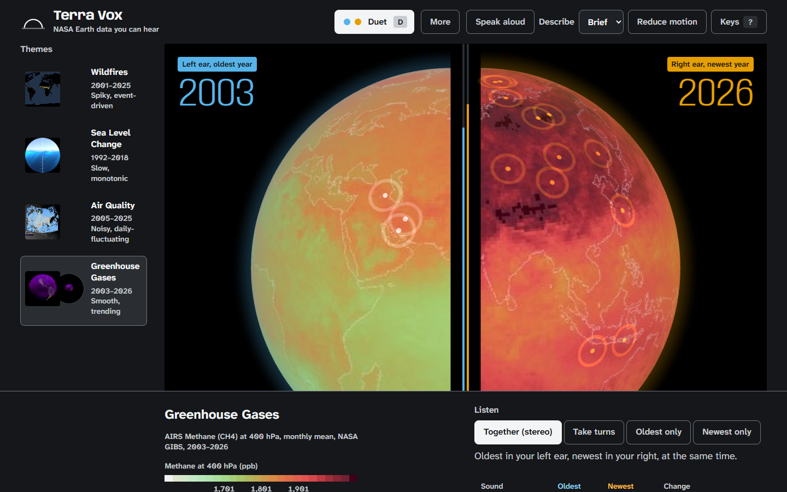

# Terra Vox

**Hear how the planet changed: oldest year in your left ear, newest in your right.**

### [▶ Try it live (headphones on)](https://demondarkness010-web.github.io/terra-vox/)



**Video (90 s):** _link goes here once recorded; script in [demo/demo-script.md](demo/demo-script.md)_

- **What it does.** An Earth Information Jukebox for NASA Space Apps 2026: it plays NASA's [Earth Information Center](https://svs.gsfc.nasa.gov/gallery/earth-information-center/) visualizations and 20+ years of the same satellites' records as live music. In **Duet**, the oldest and newest year of a theme play at once, one in each ear, through the identical mapping, so the change is the difference you hear.
- **Who it's for.** 338 million people are blind or have moderate to severe vision loss, and climate data almost always arrives as a chart. Terra Vox is built to be heard first: keyboard only, screen-reader captions generated from the data, spoken descriptions, no sight needed. _Tester result goes here, only once a session has actually happened (see [docs/submission.md](docs/submission.md))._
- **Proof the sound carries the data.** [`scripts/validate_mapping.py`](scripts/validate_mapping.py) runs every frame through the app's own mapping: pitch, loudness, density and tempo follow the measured value at **r ≥ 0.82 on all 11 tracks** (r = 1.00 for loudness everywhere). [The table](docs/mapping-explainer.md#3-proof-does-the-sound-carry-the-data).

---

## Details

### The idea in one sentence

Other sonifications play a chart over time. Terra Vox plays two moments of the planet at once, one in each ear, so the change is the difference you hear.

**Greenhouse Gases, 2003 ⟷ 2026.** Left ear: one low, calm C4 on a sine, 80 BPM. Right ear: E♭5, four notes a bar on a buzzy sawtooth at 115 BPM over a tense minor third, and louder. Methane at 400 hPa went from 1,769 to 1,887 ppb; air at or above 1,900 ppb from 0 % to 49 % of the planet.

### How it meets the challenge

From the official [Earth Information Jukebox](https://www.spaceappschallenge.org/2026/challenges/the-earth-information-jukebox/) statement:

| The statement asks for… | Terra Vox | How to try it |
|---|---|---|
| "an interface … that pairs EIC visual frames with dynamic sonifications generated in real time" | Side B plays four NASA EIC visualizations (SVS 5113, 5235, 5175, 5116) frame by frame, generated live in the browser with Tone.js | **More → Side B**, or press **F** |
| "individuals can select or experience a specific EIC visualization alongside its corresponding soundscape" | One screen: pick a theme, press play, Duet | Press **1**–**4** to play a theme, **D** for Duet |
| map "color palettes, shapes, or pixel densities … to audio parameters like pitch, tempo, or instrumentation" | NASA's own colormaps are inverted to real values; value → pitch, loudness, timbre; share of the map → notes per bar; one instrument per theme | **More → How the data plays the music** |
| "balance data interpretation with artistic, musically pleasing outputs" | Every note in C minor pentatonic; four instruments; the data link is tested (r ≥ 0.82) | Play any theme; run `validate_mapping.py` |
| "Accessibility is a core theme … screen-reader compatibility … rich descriptive text" | Keyboard only, captions and alt text generated from the data, Speak aloud, Take turns for one ear, reduced motion | Press **?**; turn on NVDA or VoiceOver |
| "how intuitively someone can select a visualization and initiate the audio" | "Put on headphones and start" drops straight into the methane Duet | Open the live link |
| "Documenting your process … the 'why' behind your artistic choices" | [docs/mapping-explainer.md](docs/mapping-explainer.md): every range, formula, limit and check | Read it |
| "how your soundscapes can reflect the urgency of climate change" | Duet: 23 years of methane in one chord | **D** on Greenhouse Gases |

### What you hear

We sonify the measurement, not the picture of it. Each frame's colours are turned back into the number NASA encoded (ppb, cm, molecules/cm², fire areas), placed on a fixed range written down for its theme, and that number plays:

- **How much** → pitch, loudness and timbre (sine → triangle → sawtooth).
- **How widespread** (share of the map past a threshold) → notes per bar.
- **How far from the oldest year** → tempo, and from a quarter of the range on, a tense third.
- **When** → stereo: oldest left, newest right. Duet plays both ends at once; single play sweeps left to right as the years advance.
- **What** → the instrument: soft pad (methane), deep bass (sea level), plucked notes (wildfires), breathy noise (air quality).

| Theme | NASA data | Years | What the sound follows |
|---|---|---|---|
| Wildfires | MODIS/Terra active fires, 8-day Aug 8–15 composite | 2001–2025 | separate fire areas, 0–300 |
| Sea Level Change | JPL MEaSUREs sea surface height (TOPEX/Poseidon, Jason-1/2/3) | 1992–2018 | mean anomaly, −5 to +10 cm |
| Air Quality | OMI/Aura tropospheric NO₂, March | 2005–2025 | one region's mean, 0–14 ×10¹⁵ molec/cm² (North China, northern India, eastern US, western Europe) |
| Greenhouse Gases | AIRS/Aqua methane at 400 hPa, August | 2003–2026 | mean, 1,750–1,950 ppb |

Wildfires: global fire hasn't simply risen, so listen to the record jump year to year. Terra's orbit has drifted since 2022; counted the same way from Aqua, Terra's 2023–2025 counts stay inside the range the two satellites agreed on before the drift ([check](scripts/check_fire_drift.py)). Air Quality follows one region at a time because the global mean barely moves: North China falling, northern India rising.

**Limits.** One snapshot per year is not an annual mean; NASA GIBS sea-surface height ends in 2018; reading values back from colours has quantisation error. [All three, explained](docs/mapping-explainer.md).

### Side B: the Earth Information Center visualizations

| Theme | Visualization | Frames | What each frame reads out |
|---|---|---|---|
| Wildfires | [SVS 5113](https://svs.gsfc.nasa.gov/5113/) Active Fires As Observed by VIIRS | 40, dated from NASA's stamp | share of land where VIIRS saw fire |
| Sea Level Change | [SVS 5235](https://svs.gsfc.nasa.gov/5235/) Sea Level Through a Porthole, 1993–2023 | 31, by water level | sea level above 1993, read off the porthole's own ruler |
| Air Quality | [SVS 5175](https://svs.gsfc.nasa.gov/5175/) TEMPO NO₂ over North America, Aug 28–31 2023 | 37 daylight scans | mean NO₂ in view, matched to the frame's colour bar |
| Greenhouse Gases | [SVS 5116](https://svs.gsfc.nasa.gov/5116/) Global Atmospheric Methane (GEOS), 2021 | 24 | share of the globe under dense methane haze |

### Accessibility

- **Sound first.** Nothing requires sight or a mouse. Every shortcut is also an on-screen control; press **?** for the list.

  | Key | Action |
  |---|---|
  | `Space` | Play / pause |
  | `[` `]` | Previous / next year (← → on the timeline) |
  | `1`–`4` | Choose a theme and play |
  | `D` | Duet on / off |
  | `L` | Duet listening mode: together, take turns, oldest only, newest only |
  | `F` | Flip the record: side A (every year) / side B (NASA EIC visualization) |
  | `R` | Repeat the description |
  | `C` | Description detail: off / brief / full |
  | `S` | Speak aloud on / off |
  | `M` | Reduce motion on / off |
  | `G` | Guess the Year / back to the jukebox |
  | `?` | Show the shortcuts |

- **Captions and alt text from the data**, synced to the bar you hear: *"2021: 1,864 ppb, 33% methane-rich air → C5, 3 notes a bar, 109 BPM, triangle, tense third."*
- **Speak aloud** for people without a screen reader, ducking the music while it talks.
- **Take turns** for one speaker, one earbud or hearing in one ear.
- **Works without WebGL or speech.** If the browser has no WebGL, the frame is shown as a flat image and the sound and captions carry on; without speech synthesis the Speak aloud button hides.
- **Lighthouse accessibility: 100** on mobile and on desktop (Lighthouse 13.6, production build, November 2, 2026). Lighthouse sees the first load, with the welcome dialog open; the jukebox behind it was checked separately with axe-core ([docs/submission.md](docs/submission.md#accessibility-checks)).

### One real use

A teacher at a school for blind students opens the link on a classroom speaker, picks Greenhouse Gases, sets Duet to **Take turns**, and asks: "Which year has more methane, the first or the second? How can you tell?" No chart, no sighted helper, and the answer is in the sound.

### Add your own dataset

Any NASA GIBS layer with a published colormap can become a theme.

1. **Define it** in [`scripts/theme_defs.py`](scripts/theme_defs.py): add an entry to `THEMES` (GIBS layer, one date per year in the same calendar window, the "active" rule in real units, the colormap URL, the physical label) and to `SOUND` (the fixed range for the value, and for the share). Pick ranges from the physics, not from your frames.
2. **Fetch and measure:** `python scripts/fetch_frames.py`, then `python scripts/extract_features.py` and `python scripts/extract_points.py`.
3. **Give it words and an instrument:** a units formatter in `PHYSICAL` and an active label in `ACTIVE` (`web/src/data/loader.js`), a map description in `MAP_DESCRIPTION` (`web/src/ui/captions.js`), and an instrument in `INSTRUMENT` (`web/src/audio/mapping.js`).
4. **Prove it:** `python scripts/validate_mapping.py` must still pass.

The app picks the theme up from `data/themes.json`; no other code changes.

### Run it

Requires Node 20.19+ or 22.12+ (Vite 8).

```bash
cd web
npm ci
npm run dev          # http://localhost:5173
```

`npm run build` writes a static site to `web/dist/` with all NASA data bundled; no backend. Every push to `main` deploys it to GitHub Pages ([.github/workflows/deploy.yml](.github/workflows/deploy.yml)).

To regenerate the data from NASA (Python 3.10+, ffmpeg for side B):

```bash
python -m venv .venv
source .venv/bin/activate            # Windows: .venv\Scripts\activate
pip install -r requirements.txt
python scripts/fetch_frames.py       # side A: GIBS frames and colormaps (data/raw_frames/, not in git, 24 MB)
python scripts/fetch_reference.py    # field guide: NOAA methane and sea level, regional OMI NO2
python scripts/extract_features.py   # measurements and sound inputs -> data/features, data/themes.json
python scripts/extract_points.py     # where each frame's signal is, for the note sparks
python scripts/fetch_eic.py          # side B: NASA SVS EIC movies, sampled and measured
python scripts/check_fire_drift.py   # Terra against Aqua
python scripts/validate_mapping.py   # exits 1 if any r < 0.8
```

### Repository

```
data/        features/ (one JSON per frame), display/ (frames as shown), points/ (note sparks),
             themes.json, eic.json + eic/ (side B), reference.json (field guide records),
             fire_check.json (Terra vs Aqua), legends.json (map keys), context.json (checked facts)
scripts/     theme_defs.py (themes and fixed sound ranges), fetch_frames.py, extract_features.py,
             extract_points.py, fetch_reference.py, fetch_eic.py, check_fire_drift.py,
             validate_mapping.py
web/src/     audio/  mapping.js (the mapping, pure), sonify.js (instruments, Voice, mix), duet.js, scales.js
             ui/     globe.js, turntable.js, themeTiles.js, captions.js, fieldGuide.js, mapKey.js,
                     mappingReadout.js, guessTheYear.js, a11y.js, tokens.js
             data/   loader.js
docs/        mapping-explainer.md, submission.md (disclosures, references, checklists)
demo/        demo-script.md (90-second video)
DESIGN.md    the design brief
```

`data/raw_frames/` (24 MB of GIBS PNGs) is no longer committed; `fetch_frames.py` rebuilds it.

### Credits and license

Imagery courtesy of NASA EOSDIS GIBS / Worldview, built on MODIS (Terra, Aqua), OMI (Aura), AIRS (Aqua) and JPL MEaSUREs altimetry. Side B visualizations and cover art are by NASA's Scientific Visualization Studio for the Earth Information Center; each track's credits are in `data/eic.json`. TEMPO data from the Smithsonian Astrophysical Observatory. Reference records from the NOAA Global Monitoring Laboratory and the NOAA Laboratory for Satellite Altimetry. NASA and NOAA do not endorse this project. Full references: [docs/submission.md](docs/submission.md#references).

Built solo with Claude Code (AI coding assistant) for implementation; the concept, data choices, mapping design and testing are mine. _(Draft: confirm or edit before submitting.)_

Code is released under the [MIT License](LICENSE).
